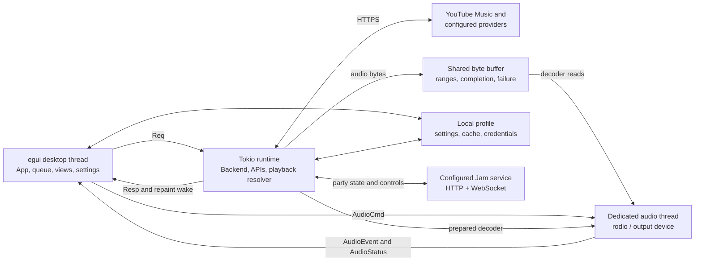

# Architecture and data flow

[Documentation home](REPOSITORY-GUIDE.md) · [API reference](APIS.md) · [Data and storage](DATA.md)

## Runtime components

`main` handles child-process flags for browser flows before normal startup. It builds one egui window, sets the application data and rendering options, and creates Crossbeam channels for backend, audio and system media events. It starts the audio output thread and constructs `Backend`, then hands the channels to `ui::App`. A callback requests a repaint when background work produces a result. Wry/Tao webviews handle sign-in and selected provider flows. [src/main.rs](../src/main.rs)

| Owner | What stays there | Handoff |
| --- | --- | --- |
| UI thread | Navigation, pages, local queue, selections, pending actions, and persistent UI preferences | Sends `Req` and `AudioCmd`. Drains `Resp`, `AudioEvent`, platform and Jam events. |
| Desktop backend | Tokio runtime, HTTP clients, YouTube session and channel, provider clients, and stream resolution | Sends typed results. Uses blocking workers for synchronous decoder and file work. |
| Audio thread | Output device, active `rodio::Player`, decoder lifecycle and transition state | Reads commands and publishes atomic status plus discrete events for transitions, errors and track completion. |
| Shared streaming buffer | Compressed bytes, chunk decisions, active reader position, and completion/error state | Network workers write bytes. `StreamReader` implements the synchronous decoder's read/seek interface. |
| Hosted services | Catalogs, media, provider content and Jam coordination | Typed desktop objects are built from external JSON or other payloads. |

Sources [main.rs](../src/main.rs), [backend.rs](../src/backend.rs), [audio.rs](../src/audio.rs), [stream.rs](../src/stream.rs), [ui/mod.rs](../src/ui/mod.rs), [ui/responses.rs](../src/ui/responses.rs).

## Search, browse, and collection pages

1. An action sets loading state and sends an appropriate `Req` through `Backend::request`. Suggestions carry a query and round. Collection loads carry an ID and a load token.
2. The backend uses `ytmapi::Api` for the transport and functions in `ytm.rs` for the catalog operation. `Api` supplies the web client context and visitor or signed-in channel context, processes session changes, and classifies request failures.
3. The catalog parser walks YouTube Music's renderer objects. It extracts IDs, titles, artist links, duration, artwork and continuation information into `Track`, `Card`, `Shelf`, `Collection` and related structs. Unknown and incomplete rows can be skipped. Search can combine several result lists and de-duplicate by video ID.
4. The worker sends `Resp`. The UI handlers compare relevant query, round, collection, generation, or account context before consuming it. Streamed playlists can display the first page while subsequent pages append rows and their matching `setVideoId` values.

Sources [backend.rs](../src/backend.rs), [ytmapi.rs](../src/ytmapi.rs), [ytm.rs](../src/ytm.rs), [model.rs](../src/model.rs), [ui/collections.rs](../src/ui/collections.rs), [ui/responses.rs](../src/ui/responses.rs).

## From queue item to sound

1. `ui/playback.rs` chooses a track and advances the playback generation. Requests for audio, lyrics, artwork and future tracks can run independently. The generation prevents later-arriving work for the old item from replacing the new one.
2. `Backend::start_playback` resolves which track should actually play. A music video can have an alternate song version. An indexed local download can supply playable bytes, and a matching prefetch can supply an existing buffer. The listed queue identity and the playing stream identity can differ.
3. `Backend::resolve` tries configured hi-res providers when allowed. For YouTube playback, eligible high-quality playback can use the signed-in web player. The anonymous visionOS client supplies standard playback, normally with Opus preferred. Account-required tracks use the native signed-in playback path when it is available. Resolution returns the URL, format, size, duration, loudness and relevant quality metadata.
4. `stream::download` populates `Shared` as data arrives. It handles HTTP range behavior and sequential fallback. The refresh path can re-resolve an expired URL with the same format. The byte buffer tracks errors, cancellation, and the chunks relevant to active readers.
5. The backend creates the media decoder on the blocking pool and sends `AudioCmd::Start`. The audio thread uses the generation and command state to select the source and output. Duration, position, readiness, and stream stats feed the player UI.
6. Near-end or completion events drive next-track behavior, repeat, and transitions. `ui/queue.rs` owns queue rules. Playback and audio modules coordinate prefetch and crossfade. The 16-band EQ and left/right levels run on decoded PCM at the mixed output. Boosts use fixed headroom based on the combined filter response. The source codec, downloaded audio, and hi-res selection are independent of these controls.

Sources [ui/playback.rs](../src/ui/playback.rs), [ui/queue.rs](../src/ui/queue.rs), [backend.rs](../src/backend.rs), [stream.rs](../src/stream.rs), [audio.rs](../src/audio.rs), [audio/effects.rs](../src/audio/effects.rs), [opus.rs](../src/opus.rs), [dash.rs](../src/dash.rs).

The hi-res pipeline matches metadata against addon responses and may fetch a complete object for formats that need that. Dolby Atmos DASH handling can decode to stereo PCM for the desktop output path. Playback may start from a readily available stream while a later quality upgrade is attempted. Offline downloads follow the YouTube download path, write tagged `.m4a` audio and update the local download index. [hires.rs](../src/hires.rs) · [dash.rs](../src/dash.rs) · [downloads.rs](../src/downloads.rs)

## Account and library

- Google sign-in uses a child webview and a dedicated profile. WebView2 retains the platform's default device-bound session settings. The application still imports session cookies for native API calls. Authenticated requests use known HTTPS endpoints and reject redirects. A device-bound session may require signing in again when its copied cookies expire. Changing channel or signing out changes the account epoch. [login.rs](../src/login.rs) · [webmusic.rs](../src/webmusic.rs) · [ytmapi.rs](../src/ytmapi.rs) · [proxy.rs](../src/proxy.rs)
- Library reads request playlists and albums independently. Partially failed reads can leave the visible successful section in place. Playlist mutations use the remote playlist ID and, when removing a specific occurrence, the paired video ID and playlist-entry ID. [backend.rs](../src/backend.rs) · [ytm.rs](../src/ytm.rs)
- Local playlists persist snapshots of loaded playlists or queues. Opening one fills the normal playback queue from its saved tracks. Existing local downloads work offline, and the remaining tracks use normal source resolution. [local_playlists.rs](../src/local_playlists.rs) · [ui/pages.rs](../src/ui/pages.rs) · [backend.rs](../src/backend.rs)
- Upload reads the user-selected file, starts a signed YouTube Music resumable upload, and sends the bytes to the returned URL. Account history reporting follows URLs and timing returned by YouTube; it is tied to the active playback generation. [webmusic.rs](../src/webmusic.rs) · [backend.rs](../src/backend.rs) · [ytm.rs](../src/ytm.rs)
- Spotify transfer is a background job. It reads a Spotify playlist or liked tracks, searches YouTube Music, scores candidates, rechecks uncertain results and exposes a review step. It then writes a private destination playlist or likes the matched tracks. Checkpoints and a shared like-operation lock protect progress and coordinate with bulk actions in the UI. [transfer/mod.rs](../src/transfer/mod.rs) · [transfer/spotify.rs](../src/transfer/spotify.rs) · [ui/transfer.rs](../src/ui/transfer.rs)

## Lyrics, artwork and integrations

Lyrics sources run concurrently. Provider payloads are normalized to timed lines and optional timed spans, with available language and credit metadata. The UI chooses a provider and uses the playhead plus configured offsets to render the current line. Optional translation and romanization are separate work; responses carry the video ID, source and target language. [lyrics.rs](../src/lyrics.rs) · [translate.rs](../src/translate.rs) · [ui/lyric_prefs.rs](../src/ui/lyric_prefs.rs) · [ui/karaoke.rs](../src/ui/karaoke.rs)

Thumbnail loading uses an egui loader connected to the backend and has a local cache. Artwork processing produces presentation data for the player background. Apple catalog metadata can add artist presentation assets and animated cover art. Discord, Last.fm, SponsorBlock, OS media controls and the tray have dedicated adapters. [images.rs](../src/images.rs) · [art.rs](../src/art.rs) · [apple.rs](../src/apple.rs) · [motion.rs](../src/motion.rs) · [ui/integrations.rs](../src/ui/integrations.rs)

## Shared listening

The desktop joins a configured party service, keeps a local mirror of members, queue and playback, and estimates relay clock offset from ping/pong samples. Queue and state frames can arrive separately; sequence values determine whether the client needs a fresh queue. The local UI sync layer aligns playback with the party anchor and handles follower behavior. Media is resolved locally using the track metadata carried on the wire. [jam.rs](../src/jam.rs) · [ui/jam.rs](../src/ui/jam.rs)

The repository's Worker uses a different route and message contract. For its protocol, there is a single `Room` Durable Object per normalized room code and a shared `Stats` object. The room stores the latest state and tick, sends snapshots to new participants, and eventually erases expired rooms. Metrics are aggregated independently of audio or the desktop library. Details and the compatibility difference are in the [API reference](APIS.md#jam-services) and [storage guide](DATA.md#jam-durable-objects).
